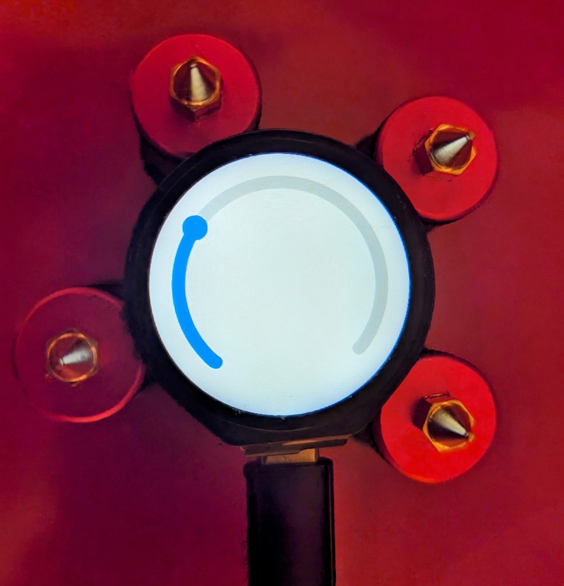

# ESP32-S3-TOUCH-LCD-1.28 — GC9A01 0.5 reference test



Reference hardware test + quick-start example for the
[Waveshare ESP32-S3-Touch-LCD-1.28](https://www.waveshare.com/wiki/ESP32-S3-Touch-LCD-1.28)
against [`gc9a01-rs`](https://github.com/IniterWorker/gc9a01) **0.5.0**.
Bare-metal (`no_std`) [esp-hal](https://github.com/esp-rs/esp-hal) +
[Embassy](https://embassy.dev), developed inside a Nix flake.

Two firmware binaries run the **identical** on-device test sequence — one
against the blocking driver, one against the async driver — and print
greppable `GC9A01-REF mode=... result=ALL-PASS` markers on UART, so the
whole thing is verifiable with a single command against a real board.

The old ESP-IDF/LVGL version of this repo lives at git tag
`pre-rewrite-espidf`.

## Quick start

```bash
nix develop              # or: direnv allow
just setup-toolchain     # one-time: espup + Xtensa `esp` toolchain
just flash-blocking      # build + flash + monitor (visual check)
just flash-async         # same, Embassy async + DMA
just hil                 # automated: flash both, capture UART, assert PASS
```

The board is expected on `/dev/ttyACM1` (CH343 USB-UART `1a86:55d3`);
override with `ESPFLASH_PORT=/dev/ttyXXX`. The Xtensa toolchain cannot
come from Nix — the devShell prints the `just setup-toolchain` hint until
`espup install --targets esp32s3` has run once, then activates the `esp`
toolchain automatically.

## What the reference test proves

Both bins (`src/bin/blocking.rs`, `src/bin/embassy_async.rs`) run, in order:

1. **BasicMode** — reset, init, then a raw 16px red/black checkerboard
   written straight to the panel (`step=basic-ok`).
2. **Fills** — full-screen RED/GREEN/BLUE/WHITE/BLACK through the buffered
   fast path, each flush timed (`step=fill color=RED flush_ms=...`;
   ~38 ms blocking, ~68 ms async+DMA on this board).
3. **Test card** — color bars, quadrant squares, diagonals, border,
   inscribed circle, center crosshair and text, drawn by the pure
   `test_card` library core (`step=card-ok`). This is the frame to eyeball:
   a red bar that is not red means a color-order regression no serial log
   can catch.
4. **Rotations** — all four `DisplayRotation`s with an up-arrow marker
   (`step=rotation value=90-ok`, ...), then back to the `Rotate180`
   default this board has always used.
5. **Brightness** — 4-step sweep (`step=brightness-ok`). Each level calls
   the driver's `set_brightness`, and mirrors it to LEDC PWM on GPIO2:
   the GC9A01 brightness register only drives the controller's LEDPWM pin,
   which is not wired to this board's backlight circuit, so the register
   alone has no visible effect here (verified on hardware).

Then `cycle=<n> result=ALL-PASS`, and the loop repeats. The async bin adds
a 1 s `step=heartbeat` task: heartbeats must interleave with the flush
lines, proving the Embassy executor stays live during DMA transfers —
`scripts/hil.sh` asserts exactly that.

Host-side gates (no hardware):

```bash
just test-host   # probe-point pixel tests of the test-card core
just check-lib   # gc9a01 driver tests + clippy (blocking/async parity)
nix flake check  # same host tests inside the Nix sandbox
```

## Wiring / pin map

| Signal | GPIO | Signal | GPIO |
|---|---|---|---|
| LCD SCK | 10 | LCD RST | 14 |
| LCD MOSI | 11 | LCD BL | 2 |
| LCD CS | 9 | I2C SDA | 6 |
| LCD DC | 8 | I2C SCL | 7 |
| Touch INT (CST816S) | 5 | IMU INT1 (QMI8658) | 4 |
| Touch RST (CST816S) | 13 | IMU INT2 (QMI8658) | 3 |

(Same constants in `src/board.rs::pins`.) The LCD runs SPI2 at 40 MHz,
mode 0. Touch and IMU are **deferred** to follow-up bins; only their pin
map is carried over so far.

## gc9a01 0.5.0 is a path dependency (for now)

Until 0.5.0 is published, `Cargo.toml` points at the sibling checkout:

```toml
gc9a01-rs = { path = "../gc9a01", version = "0.5.0", features = ["async", "graphics"], optional = true }
# After 0.5.0 publishes: gc9a01-rs = { version = "0.5.0", features = ["async", "graphics"], optional = true }
```

When switching to the crates.io line, also delete
`nix/gc9a01-0.5.0-Cargo.toml` — that stub manifest only exists so the Nix
sandbox check can resolve the sibling path dep (it is never compiled
there).

## License

Licensed under either of

- Apache License, Version 2.0 ([LICENSE-APACHE](LICENSE-APACHE) or
  http://www.apache.org/licenses/LICENSE-2.0)
- MIT license ([LICENSE-MIT](LICENSE-MIT) or http://opensource.org/licenses/MIT)

at your option.

### Contribution

Unless you explicitly state otherwise, any contribution intentionally submitted for inclusion in the
work by you, as defined in the Apache-2.0 license, shall be dual licensed as above, without any
additional terms or conditions.
