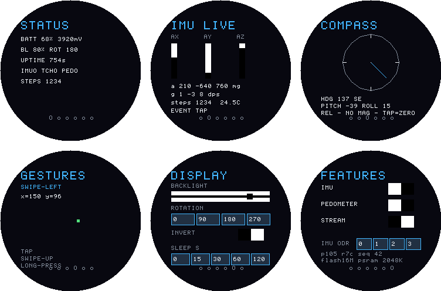

# ESP32-S3-TOUCH-LCD-1.28 — full board support + SBX sandbox



*The six sandbox pages, rendered off-device with the firmware's own
UI code (`just screenshots`; canned telemetry). Individual pages in
[`images/sandbox/`](images/sandbox). Hardware:
*

Bare-metal (`no_std`) [esp-hal](https://github.com/esp-rs/esp-hal) +
[Embassy](https://embassy.dev) support for the
[Waveshare ESP32-S3-Touch-LCD-1.28](https://www.waveshare.com/wiki/ESP32-S3-Touch-LCD-1.28),
developed inside a Nix flake. Every onboard peripheral has a driver
path and a reference-test bin, and the **SBX sandbox** ties them all
together: a touch UI on [rlvgl](https://github.com/softoboros/rlvgl)
with live sensors, a UART control protocol, and settings persisted
in flash.

The old ESP-IDF/LVGL version of this repo lives at git tag
`pre-rewrite-espidf`.

## Quick start

```bash
nix develop              # or: direnv allow
just setup-toolchain     # one-time: espup + Xtensa `esp` toolchain
just flash-sandbox       # the SBX sandbox application
just hil-sandbox         # automated UART protocol + persistence test
```

The board is expected on `/dev/ttyACM1` (CH343 USB-UART `1a86:55d3`);
override with `ESPFLASH_PORT=/dev/ttyXXX`. The Xtensa toolchain cannot
come from Nix — the devShell prints the `just setup-toolchain` hint
until `espup install --targets esp32s3` has run once, then activates
the `esp` toolchain automatically.

All bins flash with `partitions.csv` (see Flash layout below); the
runner in `.cargo/config.toml` and every HIL script already pass it.

## Board support matrix

| Peripheral | Interface | Driver | Reference bin(s) | In sandbox |
|---|---|---|---|---|
| GC9A01A LCD 240×240 | SPI2 40 MHz, GPIO10/11/12/9/8/14, BL GPIO2 LEDC PWM | `gc9a01-rs` 0.5.0 | `blocking`, `embassy_async` | ✅ rlvgl UI |
| CST816S(T) touch | I2C0 400 kHz (0x15), SDA6/SCL7, INT5, RST13 | `cst816s-rs` 0.2.0 | `touch_blocking`, `touch_async` | ✅ points + derived gestures |
| QMI8658 IMU | I2C0 (0x6B secondary), INT1=GPIO4, INT2=GPIO3 | `qmi8658` 0.2.0 | `imu_blocking`, `imu_embassy` | ✅ samples, tap/motion, pedometer |
| Battery sense | ADC1 GPIO1, 200k/100k divider (×3) | `esp-hal` ADC + `battery` module | `battery` | ✅ % + mV |
| BOOT button | GPIO0 (after boot) | `esp-hal` GPIO | — | ✅ page cycle / factory reset |
| 16 MB flash W25Q128 | boot flash (MSPI) | `esp-storage` 0.10 + `settings` module | `flash_store` | ✅ settings store |
| 2 MB PSRAM (S3R2 in-package) | quad SPI | `esp-hal::psram` + `esp-alloc` | — | ✅ heap region |
| UART0 via CH343P | GPIO43/44, 115200 | `esp-hal` UART async | all (markers) | ✅ SBX protocol |
| RESET button | EN pin | hardware | — | — |
| Native USB GPIO19/20 | — | — | — | ❌ unverified (see notes) |
| WiFi/BLE radio | — | `esp-radio` (future) | — | ❌ follow-up |

## The SBX sandbox (`src/bin/sandbox.rs`)

One Embassy application: `ui_task` (display + rlvgl + state),
`sensor_task` (shared I2C: touch + IMU), `uart_task`,
`settings_task` (debounced flash saves), `battery_task`,
`button_task`. Boot markers: `SBX step=boot`,
`SBX psram_bytes=2097152`, `SBX step=settings-loaded seq=<n|defaults>`,
`SBX step=touch-ok ...`, `SBX step=imu-ok rev=0x7c`, `SBX step=ui-ok`.

Six pages (swipe left/right or BOOT short-press to move; content is
constrained to the 168×168 round-safe center square):

0. **Status** — battery %/mV, backlight %, rotation, uptime, feature
   dots (IMU/TCH/PED), steps.
1. **IMU live** — accel bars + mg, gyro dps, steps, temperature,
   last TAP/MOTION event.
2. **Compass** — relative heading from integrated gyro yaw (no
   magnetometer on this board; footer `REL - NO MAG`), pitch/roll
   from accel, tap anywhere to zero. Expect slow drift — that's
   physics, not a bug.
3. **Gestures** — last trajectory-derived gesture, x/y, live dot,
   history. Firmware note: this unit's CST816T (proj105) never sets
   the gesture byte, so gestures are recognized from coordinates.
4. **Display** — backlight slider, rotation buttons, invert switch,
   sleep-timeout buttons (0 = never). Sleep blanks the backlight;
   any touch or BOOT press wakes (`SBX step=sleep/wake`).
5. **Features** — IMU/pedometer/stream switches, IMU ODR
   (0–3 → 112/224/448/897 Hz), chip revisions, settings seq, PSRAM.

BOOT button: short press = next page, 2 s hold = factory-reset
settings (`SBX step=settings-reset`). Touch has no disable toggle
anywhere (UI or UART) — it is always on, so settings can never
strand the device without an input path.

### UART protocol (CH343 port, 115200)

Input is parsed only when a line starts with `SBX `; anything else is
ignored (monitor noise must not spam). LF-terminated, CRLF accepted.

```
SBX GET                      -> SBX-STATE <key>=<value>  (one per key)
SBX SET backlight=37         -> SBX OK backlight=37 | SBX ERR backlight
SBX STREAM on|off            -> SBX OK stream=on|off
```

Keys: `backlight` (0–100), `rotation` (0|90|180|270),
`invert|imu|pedometer|stream` (on|off), `sleep_s` (0–3600),
`odr` (0–3), `page` (0–5); `GET` also reports `battery_mv`. While
streaming, samples print at 5 Hz:
`SBX-DATA ax_mg=.. ay_mg=.. az_mg=.. gx_mdps=.. batt_mv=..`.
Settings changes are saved to flash after 500 ms of quiet
(`SBX step=settings-saved seq=<n>`) and survive reboot —
`scripts/sandbox_hil.py` proves exactly that.

## Flash layout (`partitions.csv`)

```
# Name,   Type, SubType, Offset,  Size
settings, data, 0x06,    0x9000,  0x10000    # two 4 KiB settings slots
factory,  app,  factory, 0x20000, 0xFE0000   # everything else
```

The settings record (`src/settings.rs`): 32 bytes, magic `SBX1`,
version, monotonic `seq`, fields, CRC-32. The store alternates two
slots so a power cut mid-save keeps the previous record. Note:
`flash_store` and sandbox HIL runs mutate the stored settings
(backlight toggles) — by design, they are store exercisers.

## Reference-test bins

Each bin prints greppable UART markers; `scripts/hil*.sh` flash,
capture, and assert them. `just --list` shows every `flash-*` /
`hil-*` recipe.

| Bin | Marker family | Proves |
|---|---|---|
| `blocking`, `embassy_async` | `GC9A01-REF mode=.. result=ALL-PASS` | gc9a01 0.5 blocking vs async+DMA, identical sequence |
| `touch_blocking`, `touch_async` | `CST816S-REF .. result=ALL-PASS` | probe/config/idle/deep-sleep-wake, then live points |
| `imu_blocking`, `imu_embassy` | `QMI8658-HIL .. step=gravity-ok` | samples, self-tests, FIFO, COD, pedometer, tap/motion (`hil-imu` needs the board flat + still) |
| `battery` | `BAT-REF mv=.. pct=.. raw=..` | ADC format (values human-checked with a battery) |
| `flash_store` | `FLASH-REF step=write-read-ok seq=<n>` | settings store round-trip, seq increments per run |
| `sandbox` | `SBX ..` | python HIL: protocol + persistence across reset |

Host-side gates (no hardware): `just test-host` (test-card probes,
battery/settings codecs, state `apply()`, gesture recognizer, and
off-screen rlvgl page renders incl. the RGB565 byte-order proof),
`nix flake check`.

### Display reference test (details)

Both GC9A01 bins run, in order: **BasicMode** raw checkerboard;
**fills** RED/GREEN/BLUE/WHITE/BLACK through the buffered fast path,
flush-timed (~38 ms blocking, ~68 ms async+DMA); the **test card**
(pure `test_card` core — the frame to eyeball for color-order
regressions); all four **rotations** with an up-arrow; and a
**brightness sweep**. The sweep calls the driver's `set_brightness`
and mirrors it to LEDC PWM on GPIO2: the GC9A01 brightness register
only drives its LEDPWM pin, which is not wired to this board's
backlight MOSFET, so the register alone has no visible effect
(verified on hardware). The async bin adds a 1 s heartbeat task;
`scripts/hil.sh` asserts heartbeats interleave with DMA flushes.

### Touch findings (verified 2026-11-15, this unit)

Module reports **CST816T, project 105, fw 2**. Point-only firmware:
gesture byte never set (5000+ flick frames, MotionMask on/off), so
derive gestures from trajectories (`src/ui/input.rs` does). Slide
axes match panel axes untransformed. After `AutoSleepTime=2` this
firmware enters bus-NACKing sleep in ~0.5 s (not the documented
seconds), so the bins and sandbox set `disable_auto_sleep=true`;
without it, wake needs a touch or reset.

## Hardware notes

- **Pin map** is canonical in `src/board.rs::pins` (LCD, I2C, touch,
  IMU, BAT_ADC=1, BOOT=0, UART 43/44, USB 19/20, SH1.0 header
  15/16/17/18/21/33). LCD MISO *is* wired (GPIO12); the reference
  bins simply never read the panel.
- **SH1.0 header**: GPIO15, 16, 17, 18, 21, 33 + VSYS/GND. GPIO33
  is free on this R2 (quad PSRAM) SoC; on octal-PSRAM variants it
  would be a PSRAM data line.
- **Unpopulated MOSFET footprints Q3/Q4** share GPIO4/GPIO5 —
  documentation only; the pins stay IMU_INT1/TP_INT.
- **Charger**: ETA6096 STAT drives an LED only (no GPIO), so charge
  state is not software-readable; voltage/trend only. With no
  battery attached the sense node floats high (~9.4 V indicated).
- **Panel inversion polarity**: the gc9a01 init sequence leaves
  INVON (`0x21`) set, and this module needs it for correct color —
  INVOFF renders colors inverted (a dark UI looks white). The
  sandbox's user-facing `invert` setting is therefore negated at
  the register (`invert=off` → INVON).
- **Native USB (GPIO19/20)**: the Rev3 schematic puts 0 Ω links
  between the ESP USB pins and the CH343-side Type-C lines — usable
  or bridge-fighting is **unverified; nothing here builds on it**.
- **Pedometer**: works on this unit's QMI8658 (rev 0x7C); if a
  variant ever rejects it, the sandbox marks it unsupported rather
  than faking counts.
- Sources: [Waveshare wiki](https://www.waveshare.com/wiki/ESP32-S3-Touch-LCD-1.28)
  (+ pinout table and Rev3 schematic linked there).

## License

Licensed under either of

- Apache License, Version 2.0 ([LICENSE-APACHE](LICENSE-APACHE) or
  http://www.apache.org/licenses/LICENSE-2.0)
- MIT license ([LICENSE-MIT](LICENSE-MIT) or http://opensource.org/licenses/MIT)

at your option.

### Contribution

Unless you explicitly state otherwise, any contribution intentionally submitted for inclusion in the
work by you, as defined in the Apache-2.0 license, shall be dual licensed as above, without any
additional terms or conditions.
